# 🃏 Vanilla Moded World

<p align="center">
  
</p>

<p align="center">
  <b>A seamless, high-polish vanilla-style expansion for Balatro.</b><br>
  Adding 40+ lore-friendly Jokers, custom Tarots, Spectrals, Secret Poker Hands, Planets, Vouchers, Decks, and Sleeves — all built with authentic Localthunk pixel art aesthetics and balanced mechanics.
</p>

<p align="center">
  
  
  
  
</p>

---

## 📑 Table of Contents

- [📦 Requirements & Dependencies](#-requirements--dependencies)
- [📥 Installation Guide](#-installation-guide)
- [🃏 Implemented Content](#-implemented-content)
  - [🃏 Jokers (40)](#-jokers)
  - [🔮 Tarot Cards (3)](#-tarot-cards)
  - [👻 Spectral Cards (2)](#-spectral-cards)
  - [🖐️ Poker Hands & 🪐 Planets](#️-poker-hands--planets)
  - [🎟️ Vouchers (2)](#️-vouchers)
  - [🎴 Decks & Sleeves](#-decks--sleeves)
- [🤝 Compatibility](#-compatibility)
- [🛠️ Contributing & Roadmap](#️-contributing--roadmap)

---

## 📦 Requirements & Dependencies

**Vanilla Moded World** requires **Steamodded** and the **Lovely Injector** to run.

| Dependency | Required Version | Description & Links |
| :--- | :--- | :--- |
| **Lovely Injector** | `v0.5.0+` | Mod-loader injection hook for Balatro.<br>🔗 [GitHub Repository](https://github.com/ethangreen-dev/lovely-injector) \| [Latest Releases](https://github.com/ethangreen-dev/lovely-injector/releases) |
| **Steamodded (SMODS)** | `v1.0.0+` (or `26.829.0+`) | Core Lua modding framework for Balatro.<br>🔗 [GitHub Repository](https://github.com/SteamopolliS/Steamodded) \| [Releases](https://github.com/SteamopolliS/Steamodded/releases) |

---

## 📥 Installation Guide

### Step 1: Install Lovely
1. Head to the [Lovely Releases page](https://github.com/ethangreen-dev/lovely-injector/releases) and download the appropriate release:
   - **Windows**: Download `version.dll`
   - **macOS**: Download `libversion.dylib`
   - **Linux / Steam Deck**: Download `version.dll` or `libversion.so`
2. Open your Balatro game installation directory:
   - *Steam*: Right-click **Balatro** in your Steam library $\to$ **Manage** $\to$ **Browse local files**.
3. Place `version.dll` into the game directory right next to `Balatro.exe`.

### Step 2: Install Steamodded
1. Download the latest release `.zip` from [Steamodded GitHub Releases](https://github.com/SteamopolliS/Steamodded/releases).
2. Open your Balatro application data directory:
   - **Windows**: Press `Win + R`, paste `%AppData%\Balatro\Mods`, and press Enter. (Create the `Mods` folder if it doesn't exist).
   - **macOS**: `~/Library/Application Support/Balatro/Mods`
   - **Linux**: `~/.local/share/Balatro/Mods`
3. Extract Steamodded so it sits inside:
   `%AppData%\Balatro\Mods\Steamodded\`

### Step 3: Install Vanilla Moded World
1. Clone or download this repository:
   ```bash
   git clone https://github.com/YOUR_USERNAME/VanillaModedWorld.git
   ```
   *(or download the `.zip` archive from GitHub and extract it).*
2. Place the `VanillaModedWorld` folder directly into your Balatro `Mods` folder:
   - **Windows**: `%AppData%\Balatro\Mods\VanillaModedWorld\`
   - **macOS**: `~/Library/Application Support/Balatro/Mods/VanillaModedWorld/`
   - **Linux**: `~/.local/share/Balatro/Mods/VanillaModedWorld/`
3. Launch Balatro! You should see **Vanilla Moded World** listed in the **Mods** menu in-game.

---

## 🃏 Implemented Content

### 🃏 Jokers

<details open>
<summary><b>Click to show/hide the Joker Gallery (40 Jokers)</b></summary>

| Sprite | Name | Rarity | Cost | Effect Summary |
| :---: | :--- | :---: | :---: | :--- |
| 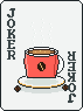 | **Espresso** | `Common` | $4 | **X2 Mult** on first hand of round. **1 in 20 chance** to transform into **Double Espresso**. |
| 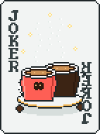 | **Double Espresso** | `Common` | $4 | Each played **2** gives **X2 Mult** when scored. *(Obtainable only when Espresso evolves!)* |
| 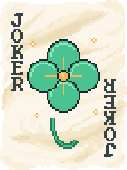 | **Lucky Clover** | `Common` | $4 | Scored **Lucky 4 of Clubs** are guaranteed to trigger all Lucky effects (**+20 Mult** and **$20**). |
| 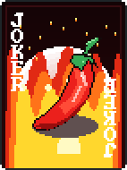 | **Hot Pepper** | `Common` | $4 | Each played card gives **X1.2 Mult** when scored. **Self-destructs** when Boss Blind is defeated. |
| 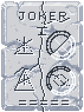 | **Stone Tablet** | `Common` | $4 | Retriggers all **Seals** on **Stone Cards** *(doubles their triggers and bonuses)*. |
| 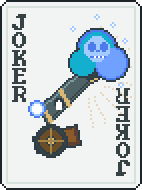 | **Overkill** | `Common` | $4 | Creates a **Spectral** card when Boss Blind is defeated if any single hand scored $\ge$ **2X** the Blind. |
| 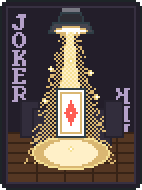 | **Spotlight** | `Common` | $4 | If played hand is a **5-card High Card**, **randomizes** the scoring card's Enhancement, Edition, and Seal. |
| 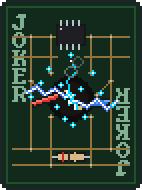 | **Short Circuit** | `Common` | $4 | If a scored card is **retriggered**, has a **1 in 2 chance** to retrigger its **neighbors** as well. |
| 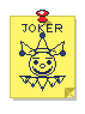 | **Sticky Note** | `Common` | $4 | Retriggers the **first card** held in hand **2 additional times**. |
|  | **Camera** | `Common` | $5 | First **numbered card** (2-10) held in hand gives **X2 Mult**. |
| 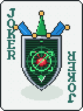 | **Antivirus** | `Common` | $4 | **+2 Chips** for each **unique card** in your full deck *(starts at +104 Chips for 52 distinct cards)*. |
| 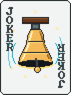 | **The Bell** | `Uncommon` | $6 | Scoring cards are **retriggered** based on distance from margins *(Gaussian distribution up to +2)*. |
| 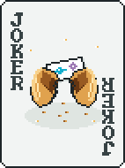 | **Fortune Cookie** | `Uncommon` | $6 | When **sold**, creates **1 Tarot** and **1 Spectral** card *(generates Spectral first if only 1 slot)*. |
| 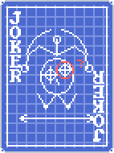 | **Wrong Schematics** | `Uncommon` | $7 | **1 in 2 chance** to copy right Joker or left Joker; copies **both** if probability reaches 2 in 2. |
| 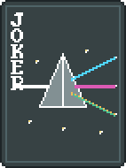 | **Magifect** | `Uncommon` | $6 | Retriggers all **Editions** (Foil, Holographic, Polychrome) for every Joker. |
| 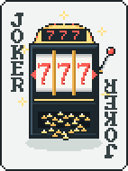 | **Jackpot** | `Uncommon` | $6 | If played hand contains at least **3 scoring 7s**, each scored 7 awards **$6**. |
| 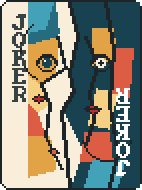 | **MultiFaces** | `Uncommon` | $6 | Converts played **2s** into **Jacks**, **3s** into **Queens**, and **4s** into **Kings** when played. |
| 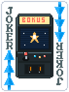 | **Bonus Stage** | `Uncommon` | $6 | Retriggers all played **Bonus Cards**. |
| 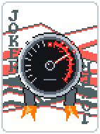 | **Overdrive** | `Uncommon` | $6 | Retriggers all played **Mult Cards**. |
| 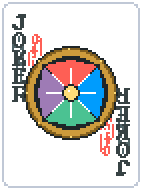 | **Kaleidoscope** | `Uncommon` | $6 | Retriggers all played **Wild Cards**. |
| 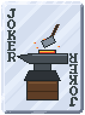 | **The Anvil** | `Uncommon` | $6 | Retriggers all played **Steel Cards**. |
| 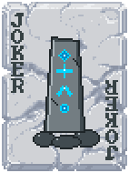 | **Monolith** | `Uncommon` | $6 | Retriggers all played **Stone Cards**. |
| 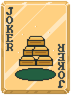 | **Bullion** | `Uncommon` | $6 | Retriggers all played **Gold Cards**. |
|  | **Glassblower** | `Uncommon` | $6 | Retrigger all played **Glass Cards**; **1 in 25 chance** to break when retriggering. |
| 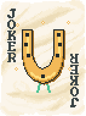 | **Golden Horseshoe** | `Uncommon` | $6 | **1 in 3 chance** to retrigger each played **Lucky Card**. |
| 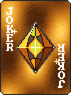 | **Sphene** | `Uncommon` | $6 | Played **Diamond** cards have a **1 in 3 chance** to be **retriggered**. |
| 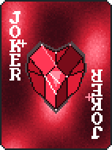 | **Ruby Heart** | `Uncommon` | $6 | Played **Heart** cards have a **1 in 3 chance** to be **retriggered**. |
| 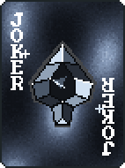 | **Black Diamond** | `Uncommon` | $6 | Played **Spade** cards have a **1 in 3 chance** to be **retriggered**. |
| 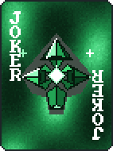 | **Emerald** | `Uncommon` | $6 | Played **Club** cards have a **1 in 3 chance** to be **retriggered**. |
| 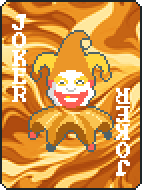 | **Frugal Joker** | `Uncommon` | $6 | Each **Diamond** card held in hand gives **$1**. |
| 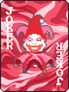 | **Fickle Joker** | `Uncommon` | $6 | Each **Heart** card held in hand has a **1 in 4 chance** to give **X1.5 Mult**. |
|  | **Stoic Joker** | `Uncommon` | $6 | Each **Spade** card held in hand gives **+25 Chips**. |
| 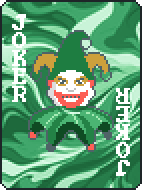 | **Stubborn Joker** | `Uncommon` | $6 | Each **Club** card held in hand gives **+4 Mult**. |
|  | **Taxi Driver** | `Rare` | $8 | Earn **$1** for each **scoring card** when hand is scored. |
| 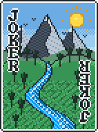 | **River** | `Rare` | $8 | Adds the **Chips** and **Mult** of the poker hand currently held in hand to scoring. |
| 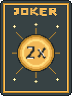 | **Doubler** | `Rare` | $8 | When **sold**, doubles all numerical values of a random owned Joker. |
| 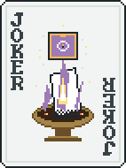 | **Burnt Offering** | `Rare` | $8 | Destroys **1 random card** from 1st played hand of round and creates a random **Tarot**. |
| 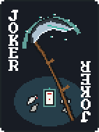 | **The Scythe** | `Rare` | $8 | If 1st hand has 3 cards, destroys 2 side cards & creates a permanent copy of middle card. |
| 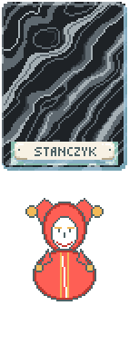 | **Stańczyk** | `Legendary` | $20 | When Boss Blind is defeated, creates a **Negative + Eternal + Rental** copy of another owned Joker. |
|  | **Sommers** | `Legendary` | $20 | Discarded **Blue Seals** permanently grant **+20 Chips**; discarded **Red Seals** grant **+X0.25 Mult**. |

</details>

---

### 🔮 Tarot Cards

| Sprite | Name | Target | Effect Summary |
| :---: | :--- | :--- | :--- |
| 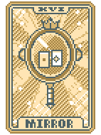 | **The Mirror** (XVI) | 2 selected cards | Converts the **left card** into the **rank and suit** of the **right card** *(preserves Enhancements, Editions, and Seals on target card)*. |
| 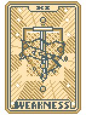 | **Weakness** (XI) | Up to 2 selected cards | **Decreases rank** of up to 2 selected cards by **1** *(2 wraps to Ace)*. Counterpart to *Strength*. |
| 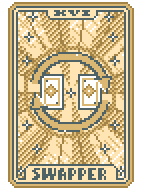 | **Swaper** (XVI) | 2 selected cards | **Swaps all Enhancements, Editions, and Seals** between 2 selected cards. |

---

### 👻 Spectral Cards

| Sprite | Name | Cost | Effect Summary |
| :---: | :--- | :---: | :--- |
| 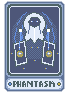 | **Phantasm** | $4 | Removes all **debuffs** from cards currently held in hand. Protects them from being re-debuffed during the round. *(Appears in shops; never spawns inside booster packs)*. |
| 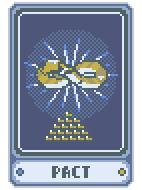 | **Pact** | $4 | Add **Eternal** to a random eligible Joker, gain **$25**. Cleanses *Perishable* if present. |

---

### 🖐️ Poker Hands & 🪐 Planets

| Type | Name | Sprite | Requirement / Hand | Base Stats / Bonus | Status |
| :---: | :--- | :---: | :--- | :---: | :---: |
| **Poker Hand** | **Quarry** | — | **5 Stone Cards** | **200 Chips, 20 Mult**<br>*(+40 Chips, +4 Mult per level)* | Secret Hand |
| **Planet** | **Nibiru** | 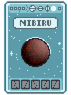 | Levels up **Quarry** | **+40 Chips, +4 Mult** | Softlocked *(appears once Quarry is played)* |

---

### 🎟️ Vouchers

| Sprite | Name | Tier | Cost | Prerequisite | Effect |
| :---: | :--- | :---: | :---: | :---: | :--- |
| 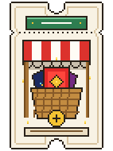 | **Market** | Tier 1 | $10 | — | **+1 Booster Pack slot** available in shop. |
| 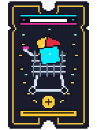 | **Supermarket** | Tier 2 | $10 | Market | **+1 Voucher slot** available in shop. |

---

### 🎴 Decks & Sleeves

| Type | Name | Sprite | Effect Summary |
| :---: | :--- | :---: | :--- |
| **Deck** | **Echo Deck** | 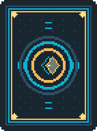 | Retriggers all **Jokers 1 additional time** (2 triggers total). Required Blind chips scale by **X Ante base size** *(Ante 1 = 1x, Ante 2 = 2x, ..., Ante 8 = 8x)*. Standard 5 Joker slots & normal reroll costs. |
| **Sleeve** | **Echo Sleeve** |  | **Standard**: Retriggers all Jokers **1 additional time**, Blinds scale by X Ante.<br>**Paired with Echo Deck**: Retriggers every **played card 1 additional time** (cards score twice!), **-1 hand size**. |

---

## 🤝 Compatibility

- **[CardSleeves](https://github.com/Larswijn/CardSleeves)**: Fully integrated optional support. The **Echo Sleeve** automatically registers and becomes available in the sleeve selection menu if CardSleeves is installed, and gracefully sleeps if it is not present.
- **[SlotManager](https://github.com/BlazeCrowner/SlotManager)**: Fully compatible — dynamically respects and allocates shop slots when **Market** (+1 Booster Pack slot) or **Supermarket** (+1 Voucher slot) are redeemed.
- **Vanilla Localthunk Style**: Strict 71×95 (1x) and 142×190 (2x) nearest-neighbor pixel enforcement with authentic Balatro palettes.

---

## 🛠️ Contributing & Roadmap

Detailed balance logs, art director prompts, and planned mechanics are documented in [`Feature_Added.md`](Feature_Added.md). Feel free to submit issues, balance feedback, or feature suggestions on the GitHub repository!
